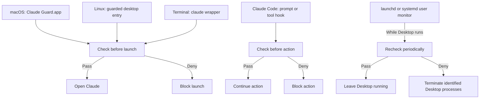

# Claude Geo Guard

Check the public country and IP before opening Claude Code or Claude Desktop on macOS and Linux. If verification fails, the guard blocks the launch. A background monitor periodically checks running Desktop processes.

## Install

With curl, Python 3.10+ and Claude Code 2.1.295+ installed, run this in a terminal as your regular user:

```sh
curl -fsSL https://raw.githubusercontent.com/mhbahmani/Claude-Geo-Guard/master/install.sh | sh
```

The installer previews its changes and asks for confirmation. It installs the **latest release** and defaults to **GB**. To pass options, replace the final `sh` with `sh -s -- --country DE` (choose your country), `sh -s -- --skip-desktop` (CLI only), or `sh -s -- --dev` (master).

## After installation

- **macOS:** Open `~/Applications/Claude Guard.app` and pin it to the Dock. Opening the original Claude.app bypasses the pre-launch check.
- **Ubuntu or Debian:** Open Claude from its guarded applications-menu entry.
- **CLI:** Open a new terminal and run `claude-geo-guard check` to verify your connection. Then use `claude` as usual.

To remove the guard, run `claude-geo-guard uninstall`.

## How the guard works

At each checkpoint, the guard checks the public IP and country reported by the HTTPS trace endpoints on **claude.ai** and **api.anthropic.com**. The probes send no Claude credentials or cookies. By default it also checks ifconfig.io for general network egress. If your VPN routes only Claude traffic, install with `--split-tunnel` to require just the two destination checks. Every usable address family (IPv4 and IPv6) must match the configured country. If you set an IP allowlist, each returned address must also appear on that list. A timeout, an invalid response, or a mismatch denies the check.



## Why “best effort”?

Suppose your VPN disconnects just after Desktop passes a check. The monitor waits **15 seconds by default** between checks. Claude can send traffic during that wait, while the next check runs, and while the app is closing. Launching the original Desktop executable directly also skips the first check, leaving the monitor to detect it later.

A passing check tells you which public IP each tested destination saw at that moment. With a split-tunnel VPN or an app-specific proxy, Claude’s traffic can take a different route. The guard can block a launch, block a supported Code action, or stop a running Desktop process. It cannot enforce the route of each network request.

[Installation and prerequisites](docs/installation.md) · [Configuration and usage](docs/usage.md) · [Troubleshooting](docs/troubleshooting.md) · [Security model](docs/security-model.md) · [Releases](https://github.com/mhbahmani/Claude-Geo-Guard/releases)

The guard rejects local hosts-file overrides for Claude domains. A CDN address cannot prove which country your DNS queries passed through. See [DNS and split tunneling](docs/network-checks.md).
