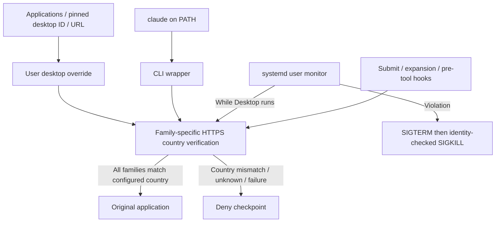

# Claude Geo Guard

`./install.sh` fetches the latest published GitHub release. Use `./install.sh --dev` for master, including before the first release. Both modes require Git, network access and Python 3.10+. For an offline source checkout run `python3 -IB run.py install`.

On macOS, install with `./install.sh`, then open or pin `~/Applications/Claude Guard.app`. If Claude is installed elsewhere, pass `--desktop-app "/absolute/path/to/Claude.app"`. The launcher checks the selected signed bundle, current network policy and monitor before opening Claude. After a Claude update, rerun installation. Opening the original Claude.app bypasses the launch check. A user LaunchAgent checks running processes periodically, so traffic can occur before detection. The guard does not register as a file or URL handler. Use `--skip-desktop` for CLI/hooks only and `./uninstall.sh` to remove the managed installation. Real Claude, Finder, Dock and login behavior still require manual acceptance. The Desktop instructions below apply to Linux.


A user-local guard that checks public egress geolocation before launching Claude and at supported Claude Code checkpoints. On Linux, Claude Desktop is monitored while running. The allowed country is configurable, with `GB` as the default. Every usable address family must return that country and a valid public IP from `https://ifconfig.io/all.json`; an optional exact IP filter can restrict it further. Unavailable or invalid verification denies access.

**This is best-effort process control, not a firewall or a security boundary against the local user.** A running Desktop application can send requests between checks and during termination. Direct executable launches, alternative activation paths, settings changes, application proxies, and destination-specific routing can bypass parts of the guard. Do not use it as proof that every Claude request originated in the UK.

Version 0.1.0 implements the installation and enforcement paths and has automated headless coverage. Real GNOME/KDE integration, Claude's execution of the hooks, and Desktop's bundled Code engine still require the [manual acceptance checklist](docs/desktop-testing.md) on your installation. Configuration presence is reported separately from functional verification.

## Protection

| Environment | Intended protection | Qualification |
|---|---|---|
| Claude Code CLI | Launch check + hooks | Wrapper must precede original on PATH; compatible Code required |
| Claude Desktop Code, local | Desktop launch check + monitor + hooks | Shared settings documented; bundled engine/version and actual hooks require manual verification |
| Claude Desktop Chat | Desktop launch check + monitor | Chat does not run Code hooks |
| Desktop remote Code | Depends on remote hook execution environment | SSH/cloud/remote containers not configured or verified by this installer |
| Direct original executable | May be detected later by Desktop monitor | Launch interception is bypassed; original CLI has no wrapper check |



## Requirements

- Ubuntu 22.04 LTS+ or Debian 12+, Python 3.10+, Linux pidfds (provided by supported distribution kernels).
- `curl`, CA certificates, `iproute2`; `systemd` with a working **user** manager for Desktop monitoring.
- Claude Code **2.1.295+**. Older/unrecognized versions are rejected because fail-closed hook errors need `onFailure: "block"`. The wrapper rechecks the version on launch.
- An installed Claude Desktop entry for Desktop protection. Native ELF executables are supported, with actions targeting the same application executable; indirect shell/script, generic Electron, Flatpak and Snap launchers are rejected for safe process identification. No app is downloaded or installed by this project.
- The OS `tzdata` package is required when selecting an explicit timezone.
- `zenity` (GNOME) or `kdialog` (KDE) provides a visible window explaining blocked Desktop launches.
- Optional: `desktop-file-utils` for installation-time validation; `libnotify-bin` for success confirmations and fallback failure notifications.

The official Linux Desktop package is the primary target. Entries and executable paths are discovered rather than hardcoded. macOS and Windows are not implemented.

## Install

Review this repository, install prerequisites using your normal package manager, then run **as your regular desktop user**, without `sudo`:

```sh
# Optional prerequisite installation; the installer never runs this itself:
sudo apt install python3 curl ca-certificates iproute2 tzdata desktop-file-utils libnotify-bin zenity

./install.sh --dry-run
./install.sh
# Or accept the printed plan for unattended installation:
./install.sh --yes
# Or select another country (ISO alpha-2 code):
./install.sh --yes --country DE
# Optionally set the timezone for newly launched Claude processes:
./install.sh --yes --country GB --timezone Europe/London
```

The installer inspects distribution, shell/session, original CLI/version, existing settings, XDG application and autostart entries, and the user manager. It shows its plan, journals original bytes in timestamped backups, copies a private Python package, creates wrappers, merges hooks, overrides desktop entries, appends marked PATH blocks, enables the monitor, and verifies JSON, wrappers, and service activity. The installer itself does not query ifconfig.io; the enabled monitor immediately checks any matching running Desktop processes and may close them if verification fails. A successful installation is possible outside the configured country; launches remain denied until verification matches.

Open a **new Bash or Zsh terminal** after installation:

```sh
claude-geo-guard check
claude-geo-guard status
claude-geo-guard doctor
claude --version
```

`claude --version` is guarded too. Use the original executable's version only when diagnosing the installation. `check` returns `0` when allowed, `2` when denied or unverifiable. `status` and `doctor` perform a live check and return `2` for denied location or configuration issues. `./install.sh --status` and `./install.sh --check` work before PATH is refreshed.

All commands are also available through `python3 -I run.py COMMAND`. Installed commands are in `${XDG_DATA_HOME:-$HOME/.local/share}/claude-geo-guard/bin`, prepended by marked shell blocks (including existing Bash login profiles). The package has no Python runtime dependencies; curl is used for reliable TLS and IPv4/IPv6 selection. A wheel is available through normal Python build tooling, but `pip install` alone does **not** install integrations: run `claude-geo-guard install` afterward.

## Normal desktop usage

Search for **Claude** in Applications and click its existing entry. The user override retains its desktop-file ID, name, icon, categories, MIME types, arguments, and actions. Each `Exec` goes through the guard; `DBusActivatable=true` becomes `false` so conforming launchers use `Exec`. System package files and original binaries are never modified. Existing user entries are backed up and changed minimally.

When a guarded Desktop launch is denied, a native error window explains why with a short heading, emphasized country values, and a next step. Country mismatches, incomplete verification, monitor failures, and executable changes have distinct explanations. Country checks show the allowed country, each returned IPv4/IPv6 country and IP side by side, and the provider (`ifconfig.io`). A failed request shows **Not verified / IP not returned**; a successful family’s returned values remain visible even if another family fails.

**Close** dismisses the window. **Show details** opens the technical reason and diagnostic command in Zenity; KDE provides an expandable Details area. No button bypasses the policy or automatically retries. After resolving the problem, open Claude again from Applications. The launcher exits with code 2 after dismissal. Dialogs inherit native themes, fonts, text scaling and keyboard controls; formatting uses escaped text without custom colors. On KDE, `kdialog` is preferred when installed; otherwise `zenity` is used. If no dialog helper or usable graphical session is available, the guard attempts a critical notification and keeps the error on stderr. CLI commands and hooks remain terminal-only. Runtime closures use the same dialog style, with a closure explanation and a journal command in Details.

XDG data/config locations, nested desktop IDs, multiple installations, and standard autostart entries are inspected. Existing pinned items that reference the desktop ID should resolve the override. Custom pinned executable commands, independent D-Bus calls, hotkeys, session restore, background services, and other app launchers may bypass it. The guard checks before reactivating an existing process through `Exec`, but cannot control an activation path that ignores `Exec`.

Unsupported entries abort installation before modifications, with a reason. A D-Bus-only entry without `Exec`, an unsafe executable, or a conflict is **not** reported as protected. Renamed entries with neither a Claude name nor a Claude executable reference cannot be discovered automatically. Use the standard package launcher. See [desktop details](docs/architecture.md) and the manual checklist.

## CLI and hooks

The private `claude` wrapper preserves argument boundaries and uses `exec` to preserve exit status and signals. It finds the original executable on PATH while excluding itself and recognizable guard wrappers. It does not replace the vendor's binary. For a nonstandard installation:

```sh
./install.sh --yes --claude-binary '/absolute/path with spaces/claude'
```

Without this option the original is rediscovered on each launch, supporting normal updates. An explicit path is retained until changed by reinstalling. Aliases/functions and shell command caches can override PATH: inspect `type -a claude`, open a new terminal, and run `hash -r` (Bash) or `rehash` (Zsh) when necessary.

Three groups are appended to `~/.claude/settings.json`: `UserPromptSubmit`, `UserPromptExpansion`, and `PreToolUse` (matcher `*`). Each uses exec form with explicit arguments, a 30-second timeout, `onFailure: "block"`, and an identifiable status message. A successful hook produces no stdout; a denied hook returns `2` with an explanation on stderr. Errors and timeouts require Code's documented fail-closed handling. Existing groups and handlers retain their order, and unrelated settings retain their values. Invalid/ambiguous JSON and conflicting guard edits abort safely.

Anthropic documents that local Desktop Code sessions share these settings and hooks. This installer checks the **standalone CLI's** version, not Desktop's bundled engine. Verify all three events and failure handling in an actual local Desktop session before relying on them. Managed settings, project restrictions, disabled hooks, different config directories, or engine changes can prevent execution. `CLAUDE_CONFIG_DIR` overrides are rejected by installation. Remote sessions run on another execution host: even when hooks are installed there, they check **that host's** egress, not your laptop's. This version does not configure remote hosts.

## Runtime policy and configuration

Your editable settings live in **`~/.config/claude-geo-guard/config.json`**, or `$XDG_CONFIG_HOME/claude-geo-guard/config.json` when XDG_CONFIG_HOME is set to an absolute path. The installer creates this small file; you can edit it with any text editor:

```json
{
  "allowed_country": "GB",
  "timezone": "Europe/London",
  "interval": 15,
  "grace": 5,
  "allowed_ips": [],
  "success_notifications": true
}
```

| Setting | Meaning |
|---|---|
| `allowed_country` | Allowed ISO country code; default `GB`. |
| `timezone` | IANA timezone for new Claude processes; `null` or `"inherit"` uses the normal environment (the default). |
| `interval` | Seconds between completed monitor cycles; 5–300, default 15. |
| `grace` | Seconds between graceful and forced termination; 0–30, default 5. This is not a retry window for network failures. |
| `allowed_ips` | Optional array of exact IPv4/IPv6 addresses. Omitted or `[]` disables IP matching; country checking remains required. |
| `success_notifications` | Optional boolean; `true` (default) confirms guarded Desktop launches, `false` disables success confirmations. |

The first four keys are required; the last two are optional. Use valid JSON with no comments or trailing commas; duplicate/unknown keys, wrong types and out-of-range values are rejected. Save the complete file atomically where your editor supports it: incomplete or invalid saves deny new checks and cause the running monitor to stop protected apps at its next cycle. It logs the configuration error and keeps running so it can recover after you fix the file. `claude-geo-guard doctor` reports validation errors, the config path and current settings, and also performs a live country check.

Country edits apply to subsequent checks. The service reloads interval/grace at each cycle, after any current wait; no restart is needed. Timezone edits apply only to newly launched processes—fully quit and reopen Desktop. Reinstallation retains saved values unless you supply explicit installer flags. The `set-country` and `set-timezone` commands edit this same file atomically.

When `allowed_ips` is nonempty, **every usable family must return both the allowed country and an address in the list**. For dual stack, include the permitted IPv4 and IPv6 addresses; listing only IPv4 will deny a usable IPv6 connection. Matching uses canonical exact addresses, not CIDR ranges, hostnames or wildcards. Use the addresses in `claude-geo-guard check`’s `ips` field when configuring the list; IPv6 spelling is normalized.

Successful Desktop launches show a short **Claude connection verified** notification with the country and returned IP, whether IP matching is enabled or not. Failure windows show the same returned values. Success confirmations require `notify-send` (`libnotify-bin`) and follow your desktop’s notification/Do Not Disturb preferences. The monitor never shows success/recovery notifications and never opens or restarts Claude. Set `success_notifications` to `false` to disable launch confirmations. Failure windows always remain enabled. CLI `check` returns country/IP data as JSON; successful hooks remain silent.

ifconfig.io’s [documented JSON endpoint](https://ifconfig.io/) at `https://ifconfig.io/all.json` returns `country_code` and `ip` in one response. The guard now uses this endpoint instead of the country-only endpoint, with one TLS-verified request per usable family. The IP and country therefore describe the same provider observation. Missing/invalid JSON fields, non-public or wrong-family IPs and policy changes during checking deny access. No stale IP is substituted when the provider is unavailable.

Installer ownership records and Base64 restoration copies remain private internal state under `~/.local/state/claude-geo-guard/manifest.json` and `backups/`. They are not runtime settings and do not belong in config.json. There is no legacy-settings fallback or migration layer. If an installed guard has no config.json, create the complete file above with your desired values before reinstalling, or provide all four options explicitly:

```sh
./install.sh --yes --country GB --timezone Europe/London --interval 15 --grace 5
```

Uninstall removes an untouched, installer-created config, but retains pre-existing or user-edited preferences, including edits made before a later reinstall. The [example config](templates/config.json) shows first-install defaults.


Select one allowed country during installation with `--country CODE`. A first installation defaults to `GB`; reinstalling without `--country` retains your saved selection. Codes are case-insensitive ISO 3166-1 alpha-2 values, such as `GB`, `DE`, `FR` or `US`. The informal alias `UK`, country names and lists of countries are rejected.

Change it afterward without reinstalling:

```sh
claude-geo-guard set-country DE
claude-geo-guard status
```

The command atomically updates the saved policy, creates a backup journal, and leaves your hooks, launcher entries and other settings untouched. The new country applies at the next launch, hook or monitor check; no service restart is required. A running Desktop process may be closed on the next monitor check if its egress no longer matches. A country change during an in-flight verification denies that check and asks you to retry. Invalid or unreadable saved policy data denies verification.

`check`, `status`, `doctor`, and runtime logs show the configured `allowed_country`. The country lives in config.json; the installation manifest remains internal restoration state.

### Optional application timezone

Set a timezone at installation with `--timezone Europe/London`, or change it afterward:

```sh
claude-geo-guard set-timezone Europe/Berlin
claude-geo-guard status
# Remove the override and inherit the launcher's usual environment:
claude-geo-guard set-timezone inherit
```

Use a case-sensitive IANA timezone name, such as `Europe/London`, `Asia/Tehran`, or `America/New_York`; `UTC` is also supported. Names are validated against the timezone database, and an explicit selection requires the OS `tzdata` package. The default is **inherit**: preserve any existing `TZ` environment variable, or let the application use its normal system default. Reinstallation without `--timezone` retains the saved choice; `--timezone inherit` clears it.

This setting passes `TZ` to newly launched Claude CLI and Desktop processes and their inheriting children. **Fully quit Desktop and relaunch it through Applications, and start new CLI sessions, after changing it.** Activating an already-running Desktop instance cannot change that process's environment. The monitor does not rewrite running process environments or restart Claude for this setting.

The system timezone, clock, shell environment, and systemd user-manager environment are unchanged. No root privileges are needed. Timezone is independent of allowed country: changing one does not select or modify the other. It does not change the public IP or which country is allowed. The complete config is validated at checkpoints, so an invalid timezone value also denies checks until repaired. The override only reaches guarded launches; remote sessions and app components that ignore `TZ` require separate verification. `status` and `doctor` show the saved `timezone` (`null` means inherit), not proof of the timezone rendered by an already-running app.

```sh
./install.sh --yes --interval 15 --grace 5
systemctl --user status claude-geo-guard.service
journalctl --user -u claude-geo-guard.service
```

The user service starts with the user manager and does not require a terminal or root. Default interval: 15 seconds **after each completed cycle**, plus the check's duration; grace: 5 seconds. Configurable ranges are 5–300 seconds and 0–30 seconds respectively. No requests are made while no protected Desktop processes are found. On violation, the monitor refreshes the process tree, sends SIGTERM, then SIGKILL to surviving identified processes. It never restarts Claude. Persistent journal logging is governed by your system's journald configuration.

After a runtime violation, an error window explains why Claude was closed. Its **Show details** view includes the failure reason and the command for reading the journal. The dialog runs in a separate worker: leaving it open does not pause checks or termination. Only one runtime window is shown at a time; additional incidents still appear in the journal. Closing the window never relaunches Claude. Stopping the monitor also closes its dialog helper. If the service cannot display a window, it attempts a notification and logs the UI failure.

To inspect closures or watch new checks:

```sh
journalctl --user -u claude-geo-guard.service -n 100 --no-pager -o short-iso
journalctl --user -u claude-geo-guard.service -f
```

`runtime_check` records the verdict, country codes, provider and process count. `runtime_stop_requested` records why termination began; `runtime_stop_finished` means the termination routine returned, not proof of network isolation. Provider failures identify the address family, a safe error category, curl exit code and HTTP status when available. For example, `IPv4: provider request timed out (curl exit 28)` distinguishes a timeout from a country mismatch. Raw provider bodies, headers and credentials are not logged; the monitor journal omits observed IP addresses. CLI check output, Desktop failure stderr and UI messages include returned IPs as requested. Old entries containing only `CalledProcessError` cannot reveal the original curl exit code retroactively. One failed verification still triggers closure under the existing fail-closed policy; this update does not introduce retries or a grace period for connectivity failures.

Process selection uses exact executable paths, the current UID, `/proc` ancestry and process start times. Signals use pidfds, with identity revalidation, to avoid killing a reused PID. Previously observed children remain tracked after reparenting during the monitor's lifetime. Already detached children that have never been observed, and children surviving a monitor restart without a recognizable executable, may be missed.

Launches through the desktop override require an active monitor. An inactive monitor denies a new guarded launch; an already running app is not automatically isolated if the monitor dies. Service restarts are rate-limited. Restart existing Claude sessions after installation so settings are loaded, and review the journal for running instances.

For a headless machine or an intentionally CLI-only install:

```sh
./install.sh --yes --skip-desktop
```

This explicitly leaves Desktop unprotected. Changing an existing Desktop installation to CLI-only requires uninstall first. The provider URL remains fixed; the saved country selection is shared by all protection layers and has no environment override. There is no allow cache, telemetry, automatic observed-IP history file, or firewall modification. Explicit allowed IPs are stored in your config and its backups; your desktop may retain notification history.

## Networking and VPNs

IPv4 and IPv6 are checked independently; **every usable family must return the configured country**. With the default GB policy, a GB IPv4 result plus non-GB or unverifiable IPv6 denies access. A genuinely single-stack connection matching the selected country is allowed; no usable routes denies access. Route, rule and interface snapshots before and after verification detect many network changes, but cannot eliminate time-of-check/time-of-use races or changes that revert between snapshots.

With the default GB policy, a routed UK VPN may satisfy the policy, including when the user is physically elsewhere. The provider observes public egress, not physical location. Geolocation can be wrong or delayed. Destination/UID/port-specific VPN routing can make Claude use a different egress from the provider or route probes. See [security model](docs/security-model.md).

Nonempty HTTP(S)/ALL proxy variables cause denial because family-specific verification through a proxy would be ambiguous. Curl proxying and `.curlrc` are disabled for the request; normal certificate validation stays enabled. Application-internal proxies cannot be detected reliably. Requests require HTTP 200 and an ISO country code. Connection timeout is 2 seconds, HTTPS total timeout 6 seconds per family, with an 8-second subprocess watchdog; families are queried concurrently. Each route command has a 1-second timeout. Hook timeout is 30 seconds. Network failures close Desktop on the next completed check, including during outages and provider rate limiting.

## Updating and uninstalling

Run `./install.sh --dry-run` and `./install.sh --yes` from the new checkout to update. No duplicate hooks or PATH blocks are created. Rerun after Desktop package updates: a same-path binary replacement remains monitored, while changed launcher paths are refreshed by reinstallation. A stale/missing executable fails closed. `doctor` reports changed source entries. Review newly added Desktop launch methods after updates.

```sh
./uninstall.sh
# Or, while installed:
claude-geo-guard uninstall
```

Uninstall stops/disables the service, removes exact owned hooks, restores original desktop launch commands, removes managed PATH blocks and package files, and retains backups. It merges against **current** settings rather than restoring a stale backup. New preferences, hooks and unrelated shell/desktop edits survive. Edited/combined owned hooks, modified managed files or changed launch commands cause an explicit conflict: reconcile before retrying. Normal original Claude executables are left intact. Empty directories and retained journals may remain; user-created files are never recursively deleted.

See [installation and recovery](docs/installation.md) and [troubleshooting](docs/troubleshooting.md).

## Development

```sh
python3 -m venv .venv
.venv/bin/pip install -r requirements-dev.txt
make check
make package
```

Tests use temporary HOME/XDG directories, fake network/systemd commands and native test processes. They never install into your real home and normal CI never queries ifconfig.io or requires Claude. Optional live verification: `make smoke-live` (outside the configured country or without verification this intentionally returns `2`). GitHub Actions also offers an explicitly enabled live smoke job.

See the [actual validation record](docs/validation.md) for performed checks and outstanding acceptance work.

Read [CONTRIBUTING.md](CONTRIBUTING.md), [SECURITY.md](SECURITY.md), and the [manual desktop checklist](docs/desktop-testing.md). See [architecture](docs/architecture.md) for module responsibilities and future network isolation work. MIT licensed; independent project, not affiliated with Anthropic.

## Primary references

Documentation reviewed 2026-11-14:

- [Official Desktop installation and Linux requirements](https://support.claude.com/en/articles/10065433-install-claude-desktop)
- [Desktop Code and shared settings](https://code.claude.com/docs/en/desktop)
- [Hook configuration, events, exec form and failure behavior](https://code.claude.com/docs/en/hooks)
- [Claude Code changelog](https://code.claude.com/docs/en/changelog) — exec form introduced in 2.1.139; `onFailure` for command hooks in 2.1.295
- [FreeDesktop Desktop Entry Specification](https://specifications.freedesktop.org/desktop-entry/latest-single/)
