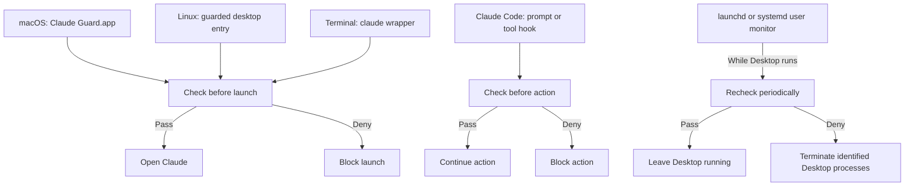

# Claude Geo Guard

Check the public country and IP before opening Claude Code or Claude Desktop on macOS and Linux. If verification fails, the guard blocks the launch. A background monitor periodically checks running Desktop processes.

## Install

With curl, Python 3.10+ and Claude Code 2.1.295+ installed, run this in a terminal as your regular user:

```sh
curl -fsSL https://raw.githubusercontent.com/mhbahmani/Claude-Geo-Guard/master/install.sh | sh
```

Run without flags for guided setup. Press Enter to accept each value in brackets, including your saved settings on reinstall. Review the plan, then press Enter to install or type `no` to cancel. Use `--yes` for unattended installation or `--dry-run` for a preview. It installs the **latest release** and defaults to **GB**. To pass options, replace the final `sh` with `sh -s -- --country DE` (choose your country), `sh -s -- --skip-desktop` (CLI only), or `sh -s -- --dev` (master).

## After installation

- **macOS:** Open `~/Applications/Claude Guard.app` and pin it to the Dock. Opening the original Claude.app bypasses the pre-launch check.
- **Ubuntu or Debian:** Open Claude from its guarded applications-menu entry.
- **CLI:** Open a new terminal and run `claude-geo-guard check` to verify your connection. Then use `claude` as usual.

Setup asks whether to enable the guard immediately. Press Enter for yes on first install, or choose no to enable it later with `claude-geo-guard enable`. Use `claude-geo-guard disable` to turn protection off again. While disabled, the CLI wrapper and Desktop launcher warn before opening Claude, hooks allow actions, and the runtime monitor stays idle.

To remove the guard, run `claude-geo-guard uninstall`.

## How the guard works

The guard checks the **public source IP** seen by each destination over IPv4 and IPv6 where usable. The server IP returned by DNS is a different address. The probes send no Claude credentials or cookies.

| Destination | What it reports | Default | `--split-tunnel` |
|---|---|---|---|
| `claude.ai/cdn-cgi/trace` | Client IP and country seen by the Claude web edge | Required | Required |
| `api.anthropic.com/cdn-cgi/trace` | Client IP and country seen by the API edge | Required | Required |
| `ifconfig.io/all.json` | Client IP and country seen by an unrelated site | Required | Skipped |

For a GB policy, both Claude destinations must report GB even in split-tunnel mode. They may see different UK IPs. If you configure an IP allowlist, **each** observed IP must be on it. A failed required probe blocks the checkpoint. Run `claude-geo-guard check` to see the observations by destination and address family.



## Why “best effort”?

Suppose your VPN disconnects just after Desktop passes a check. The monitor waits **15 seconds by default** between checks. Claude can send traffic during that wait, while the next check runs, and while the app is closing. Launching the original Desktop executable directly also skips the first check, leaving the monitor to detect it later.

The two Claude traces test destination-specific routing directly. For example, if the web trace sees a UK IP but the API trace sees a German IP, a GB policy denies access in either mode. A passing result describes those probe connections at that moment. A later request, another hostname, or a proxy configured inside Claude can use a different route. The guard cannot enforce the route of every application request.

[Installation and prerequisites](docs/installation.md) · [Configuration and usage](docs/usage.md) · [Troubleshooting](docs/troubleshooting.md) · [Security model](docs/security-model.md) · [Releases](https://github.com/mhbahmani/Claude-Geo-Guard/releases)

The guard rejects local hosts-file overrides for Claude domains. A CDN address cannot prove which country your DNS queries passed through. See [DNS and split tunneling](docs/network-checks.md).
