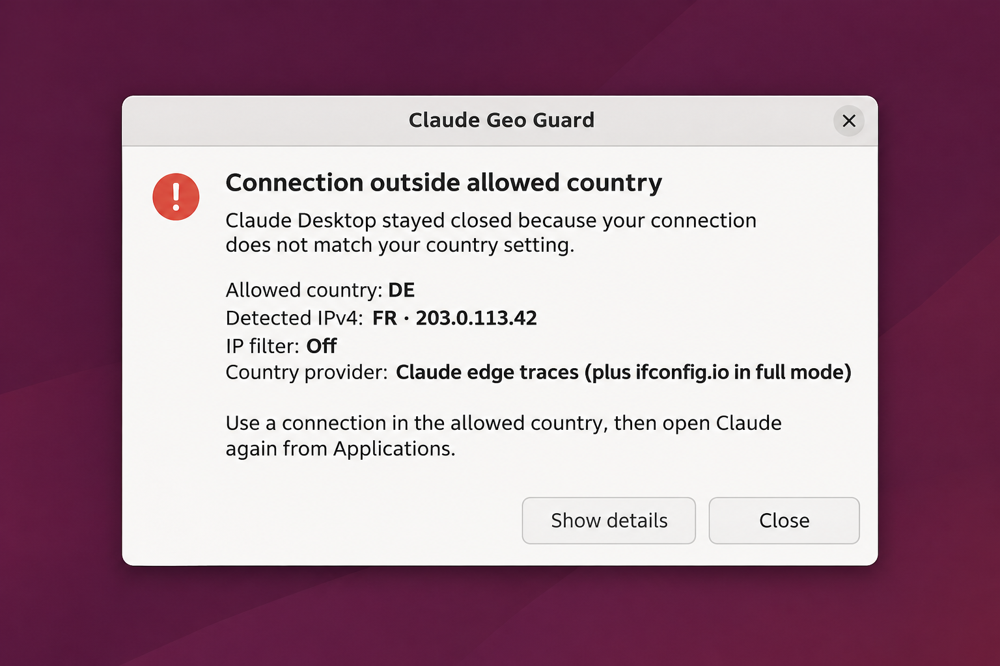
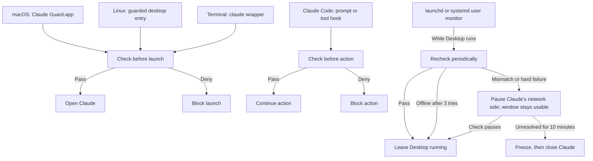

# Claude Geo Guard

Check the public country and IP before opening Claude Code or Claude Desktop on macOS and Linux. If verification fails, the guard blocks the launch. A background monitor periodically checks running Desktop processes.



## Install

With curl, Python 3.10+ and Claude Code 2.1.295+ installed, run this in a terminal as your regular user:

```sh
curl -fsSL https://raw.githubusercontent.com/mhbahmani/Claude-Geo-Guard/master/install.sh | sh
```

Run without flags for guided setup. Press Enter to accept each value in brackets, including your saved settings on reinstall. Review the plan, then press Enter to install or type `no` to cancel. Use `--yes` for unattended installation or `--dry-run` for a preview. It installs the **latest release** and defaults to **GB**. To pass options, replace the final `sh` with `sh -s -- --country DE` (choose your country), `sh -s -- --skip-desktop` (CLI only), or `sh -s -- --dev` (master).

## After installation

- **macOS:** Open `~/Applications/Claude Guard.app` and pin it to the Dock. Opening the original Claude.app bypasses the pre-launch check.
- **Ubuntu or Debian:** Open Claude from its guarded applications-menu entry.
- **CLI:** Open a new terminal and run `claude-geo-guard check` to verify your connection. Then use `claude` as usual.

Setup asks whether to enable the guard immediately. Press Enter for yes on first install, or choose no to enable it later with `claude-geo-guard enable`. Use `claude-geo-guard disable` to turn protection off again. While disabled, the CLI wrapper and Desktop launcher warn before opening Claude, hooks allow actions, and the runtime monitor stays idle.

With protection enabled, the Desktop launcher shows a progress window while checking your public IP and country. The CLI shows animated dots in the terminal, or a single status line when stderr is redirected. Claude starts only after verification succeeds. A timeout keeps it closed. On Linux, reinstall from this checkout with `python3 -IB run.py install --yes` to repair an existing Claude-generated menu entry.

Cursor can import Claude Code hooks. The guard silently skips Cursor Agent’s own hook events. Running the `claude` CLI from Cursor’s terminal still uses the guard.

Run `claude-geo-guard check` for a connection report or `claude-geo-guard doctor` to diagnose the installation. Add `--json` to either command for scripts.

Run `claude-geo-guard` without arguments for the command guide. On Linux, inspect the runtime monitor journal with:

```sh
claude-geo-guard last-stop               # Explain the last recorded closure
claude-geo-guard logs                    # Latest 100 entries
claude-geo-guard logs -f                 # Follow live; Ctrl-C exits
claude-geo-guard logs -n 200 --since today
claude-geo-guard logs --json --no-pager  # Journal JSON for scripts
```

`last-stop` reads retained Linux journal records; it does not run a new connection check. It shows when the monitor requested termination, why, and the country evidence recorded at that time. It does not cover application crashes or manual exits. Use `check` for your connection now, `doctor` for installation diagnostics, and `doctor --json` for the former `status` output.

To remove the guard, run `claude-geo-guard uninstall`.

## Configuration

Settings live in `~/.config/claude-geo-guard/config.json` (`$XDG_CONFIG_HOME/claude-geo-guard/config.json` when set; `~/Library/Application Support/claude-geo-guard/config.json` on macOS). Edit it with any text editor and save valid JSON. Reinstalling keeps your values. The monitor rereads the file at every check, so no service restart is needed. The last column says what has to happen before a change applies.

| Key | Default | Meaning | Applies |
|---|---|---|---|
| `enabled` | `true` | Turns protection on or off. Prefer `claude-geo-guard enable` / `disable`. | Next launch, hook or monitor cycle |
| `allowed_country` | `"GB"` | ISO country code every check must report. Or run `claude-geo-guard set-country CODE`. | Next check |
| `allowed_ips` | `[]` | Exact public IPv4/IPv6 addresses that must also match; `[]` disables IP matching. | Next check |
| `split_tunnel` | `false` | Skips the ifconfig.io probe and checks only the Claude endpoints. | Next check |
| `timezone` | `null` | IANA timezone such as `"Europe/London"` for Claude processes; `null` keeps the system timezone. Or run `claude-geo-guard set-timezone ZONE`. | Quit and reopen Claude Desktop; start a new `claude` session |
| `interval` | `15` | Seconds between monitor checks, 5 to 300. | After the current wait |
| `grace` | `5` | macOS only: seconds between a graceful and a forced close, 0 to 30. | Next closure |
| `success_notifications` | `true` | Shows a "connection verified" popup when a guarded Desktop launch passes. | Next Desktop launch |
| `offline_notifications` | `true` | Shows a notification when the connection cannot be verified and again when it is verified. Claude keeps working either way. | Next check |

The required keys are `allowed_country`, `timezone`, `interval` and `grace`. An invalid file counts as a failed check until you fix it: launches are blocked and the monitor stops running Claude. `claude-geo-guard doctor` names the problem. A manually started monitor (`claude-geo-guard monitor --interval N`) uses its flags instead of the file; on Linux, `systemctl --user restart claude-geo-guard.service` returns the service to the file's values.

## How the guard works

The guard checks the **public source IP** seen by each destination over IPv4 and IPv6 where usable. The server IP returned by DNS is a different address. The probes send no Claude credentials or cookies.

| Destination | What it reports | Default | `--split-tunnel` |
|---|---|---|---|
| `claude.ai/cdn-cgi/trace` | Client IP and country seen by the Claude web edge | Required | Required |
| `api.anthropic.com/cdn-cgi/trace` | Client IP and country seen by the API edge | Required | Required |
| `ifconfig.io/all.json` | Client IP and country seen by an unrelated site | Required | Skipped |

For a GB policy, both Claude destinations must report GB even in split-tunnel mode. They may see different UK IPs. If you configure an IP allowlist, **each** observed IP must be on it. A probe that reports another country, or fails for any reason other than a timeout or unreachable network, blocks the checkpoint. If one Claude destination verifies the country and the others only time out, the check passes. If nothing can be verified, running Claude keeps working and new launches wait. Run `claude-geo-guard check` to see the observations by destination and address family.



## Why “best effort”?

Suppose your VPN disconnects just after Desktop passes a check. The monitor waits **15 seconds by default** between checks. Claude can send traffic during that wait and while the next check runs. On Linux, a routing change wakes the monitor immediately and pauses Claude's network side until the new network is verified, which narrows the window but does not close it. A failed check pauses rather than closes Desktop; it reconnects after the next passing check. Launching the original Desktop executable directly also skips the first check, leaving the monitor to detect it later.

The two Claude traces test destination-specific routing directly. For example, if the web trace sees a UK IP but the API trace sees a German IP, a GB policy denies access in either mode. A passing result describes those probe connections at that moment. A later request, another hostname, or a proxy configured inside Claude can use a different route. The guard cannot enforce the route of every application request.

[Installation and prerequisites](docs/installation.md) · [Configuration and usage](docs/usage.md) · [Troubleshooting](docs/troubleshooting.md) · [Security model](docs/security-model.md) · [Releases](https://github.com/mhbahmani/Claude-Geo-Guard/releases)

The guard rejects local hosts-file overrides for Claude domains. A CDN address cannot prove which country your DNS queries passed through. See [DNS and split tunneling](docs/network-checks.md).
